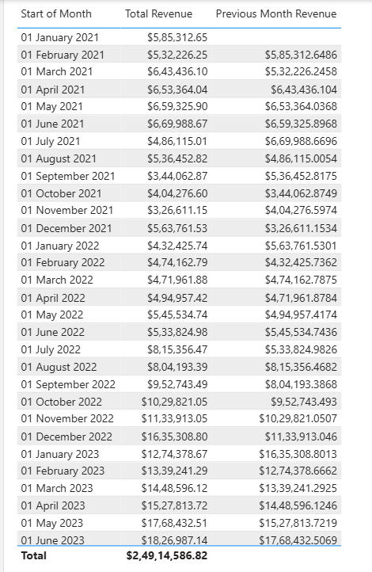
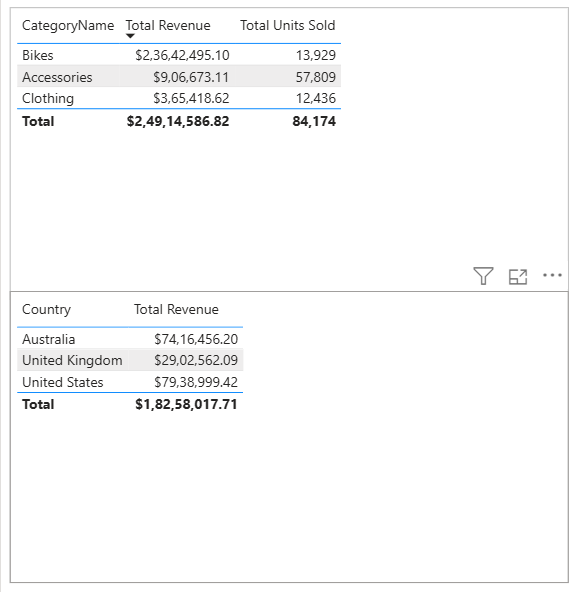

# Adventure Works Sales Executive Dashboard

An interactive **Power BI sales dashboard** built to monitor revenue,
profit, sales volume, product categories, country performance, and
monthly trends for Adventure Works.

## Dashboard Preview


## Additional Report Views

### Monthly Revenue Details



### Revenue by Product Category and Country



## Business Questions

This dashboard helps answer questions such as:

-   How much revenue and profit has the business generated?
-   How many units have been sold, and what is the average selling
    price?
-   How is weekly revenue changing over time?
-   Which countries contribute the most revenue and profit?
-   Which product categories sell the most units?
-   What are the month-over-month changes in revenue, units sold, and
    profit?
-   Which product is ordered most often, and which product is a key
    revenue driver?

## Key Dashboard Metrics

The dashboard highlights these headline KPIs:

  KPI                       Displayed value
  ----------------------- -----------------
  Revenue                          \$24.91M
  Units Sold                         84.17K
  Average Selling Price            \$295.99
  Profit                           \$10.46M
  Profit Margin                      41.97%

*Values are based on the screenshots included in this repository and may
reflect the selected report filters.*

## Dashboard Features

-   **Executive KPI cards** for revenue, units sold, average selling
    price, profit, and profit margin.
-   **Weekly revenue trend** with a trend line and forecast-style
    visual.
-   **Country performance table** comparing revenue, units sold, profit,
    and profit margin.
-   **Units sold by category** for Accessories, Bikes, and Clothing.
-   **Monthly KPI cards** showing current-month performance and
    comparison with the previous month.
-   **Product highlights** for the most ordered product and a key
    revenue driver.
-   **Detailed monthly revenue table** with previous-month revenue for
    comparison.

## Tools and Technologies

-   **Power BI** --- dashboard design and interactive data visualization
-   **DAX** --- KPI and business metric calculations *(if used in the
    report)*
-   **Power Query** --- data cleaning and transformation *(if used in
    the report)*

> Update the tools list to match the exact methods used in your project.

## Insights Visible in the Report

-   Accessories lead unit sales, with approximately **57.8K units**
    sold.
-   Bikes account for approximately **13.9K units**, while Clothing
    accounts for approximately **12.4K units**.
-   The United States has the highest displayed country revenue,
    followed by Australia.
-   Weekly revenue generally trends upward across the period shown, with
    fluctuations between weeks.
-   The report displays a **41.97% profit margin** overall.

These observations are based only on the provided screenshots; verify
them against the underlying Power BI model before using them in a
business presentation.

## Repository Structure

``` text
adventure-works-sales-dashboard/
├── README.md
└── images/
    ├── dashboard-overview.png
    ├── monthly-revenue-details.png
    └── category-and-country-revenue.png
```

## How to View

1.  Clone or download this repository.
2.  Open `README.md` on GitHub to view the dashboard screenshots.
3.  If you are sharing the interactive report, add the `.pbix` file or a
    Power BI Service link, making sure you have permission to share the
    data.

## Future Improvements

-   Add date, country, and product slicers for deeper analysis.
-   Include year-over-year and month-over-month growth measures.
-   Add a dedicated page for product and customer analysis.
-   Document the data source, data model, and DAX measures.
-   Publish an interactive version to Power BI Service if appropriate.

## Author

**Nikhil Sharma**

-   GitHub: [nikhilsharma-ai](https://github.com/nikhil-collegex)
-   LinkedIn:
    [collegex](www.linkedin.com/in/collegex)

------------------------------------------------------------------------

If you found this project useful, feel free to ⭐ the repository.
